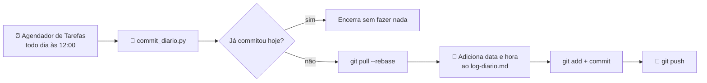

<div align="center">


<a href="https://github.com/CrystianSantos/automatizador-commit">
  
</a>

<br/>


[Sobre](#-sobre) • [Como funciona](#-como-funciona) • [Mensagens de commit](#-mensagens-de-commit) • [Instalação](#-instalação) • [Agendamento](#-agendando-no-windows) • [Dúvidas](#-problemas-comuns)

</div>

---

## 💡 Sobre

O **AutomatizadorCommit** é um script em **Python** que faz **um commit automático por dia** em um repositório do GitHub ([`Commit-Diario`](https://github.com/CrystianSantos/Commit-Diario)). Ele roda **local**, na minha máquina, e é de **uso pessoal**: sem servidor e sem custo. O **Agendador de Tarefas do Windows** dispara tudo sozinho no horário escolhido.

### 🎯 Propósito

1. **Manter o gráfico de contribuições do GitHub ativo**, com um commit automático por dia.
2. **Praticar** Python, Git/GitHub e agendamento de tarefas, construindo uma automação do início ao fim.

> ⚠️ **Transparência:** os commits do repositório `Commit-Diario` são **automáticos** e registram apenas uma linha de data e hora no arquivo `log-diario.md`. Eles **não representam trabalho de desenvolvimento**. Meus projetos reais ficam em repositórios separados.

## ⚙️ Como funciona



1. O Agendador executa o script todos os dias.
2. O script confere se já existe commit do dia, para não duplicar.
3. Sincroniza com o GitHub (`git pull --rebase`).
4. Adiciona uma linha com data e hora ao `log-diario.md`.
5. Faz `git add`, `git commit` e `git push`.
6. Se algum passo falhar, devolve código de erro `1`, que aparece no Agendador. Se tudo der certo, devolve `0`.

## 📝 Mensagens de commit

As mensagens seguem o padrão [Conventional Commits](https://www.conventionalcommits.org/pt-br/):

```
<tipo>: <descrição curta>
```

O script gera sempre esta mensagem:

```
chore: atualização diária 2026-10-07
```

- **`chore`** é o tipo para tarefas de rotina e manutenção que não adicionam funcionalidade nem corrigem bugs, que é o caso de um log diário.
- A descrição é curta e traz a data, para identificar cada execução no histórico.

| Tipo | Quando usar |
|---|---|
| `feat` | Nova funcionalidade |
| `fix` | Correção de bug |
| `docs` | Mudanças em documentação |
| `refactor` | Reorganização de código sem mudar o comportamento |
| `chore` | Tarefas de rotina e manutenção |

## 📦 Instalação

### Pré-requisitos

| Ferramenta | Pra quê | Download |
|---|---|---|
| **Git** | Fazer o commit e o push | [git-scm.com](https://git-scm.com/) |
| **Python 3** | Rodar o script | [python.org](https://www.python.org/downloads/) |
| **Conta no GitHub** | Receber os commits | [github.com](https://github.com/) |

> 💻 VS Code ou IntelliJ são opcionais, só pra editar o script se quiser.

### Passo a passo

**1️⃣ Baixe o projeto**

```bash
git clone https://github.com/CrystianSantos/automatizador-commit.git
```

Sem Git? Clique em **Code → Download ZIP** e extraia numa **pasta fixa** (ex.: `C:\Projetos\AutomatizadorCommit`). O Agendador guarda esse caminho, então não mude a pasta depois.

**2️⃣ Crie um repositório só pra receber os commits**

No GitHub, crie um repositório **seu** (não um fork), com um README inicial, e clone na sua máquina:

```bash
git clone https://github.com/SEU-USUARIO/Commit-Diario.git
```

**3️⃣ Configure sua identidade no Git**

Use o **mesmo e-mail cadastrado na sua conta do GitHub**, senão o commit não aparece no gráfico:

```bash
git config --global user.name "Seu Nome"
git config --global user.email "seu-email@exemplo.com"
```

**4️⃣ Teste na mão**

Passe como argumento o caminho do repositório clonado, **tudo em uma linha**:

```bash
python commit_diario.py C:\caminho\do\Commit-Diario
```

Apareceu `Commit de AAAA-MM-DD enviado com sucesso.` e o arquivo `log-diario.md` no GitHub? Deu certo ✅

## 🕛 Agendando no Windows

**Jeito rápido (uma linha no Prompt de Comando):**

```bash
schtasks /create /tn "CommitDiarioGitHub" /tr "python C:\caminho\commit_diario.py C:\caminho\do\Commit-Diario" /sc daily /st 12:00
```

**Jeito pela interface:**

1. Abra o **Agendador de Tarefas** (`taskschd.msc`) e clique em **Criar Tarefa Básica**
2. Nome: `CommitDiarioGitHub` · Gatilho: **Diariamente** (eu uso 12:00)
3. Ação: **Iniciar um programa**
4. **Programa/script:** `python`
5. **Adicione argumentos:** `C:\caminho\commit_diario.py C:\caminho\do\Commit-Diario`
6. Salve, clique com o botão direito na tarefa → **Executar** pra testar

Para conferir, veja a coluna **Resultado da Última Execução** no Agendador:

> ✅ **`0x0`** = tudo certo.

## 🛠️ Problemas comuns

<details>
<summary><b>O PC estava desligado no horário</b></summary>
<br/>
Nas propriedades da tarefa, aba <b>Configurações</b>, marque a opção de executar assim que possível caso um início agendado tenha sido perdido. Em notebook, desmarque também a exigência de estar na tomada (aba <b>Condições</b>).
</details>

<details>
<summary><b>O git push pede senha</b></summary>
<br/>
Configure um token de acesso pessoal do GitHub, use chave SSH ou o Git Credential Manager. O push precisa funcionar sem pedir nada, senão a tarefa fica esperando.
</details>

<details>
<summary><b>A tarefa roda mas o quadradinho não aparece no GitHub</b></summary>
<br/>
Confira: (1) o e-mail do <code>git config</code> está cadastrado na sua conta; (2) o repositório é seu e não é um fork; (3) o commit está na branch padrão; (4) se o repositório for <b>privado</b>, ative <b>Private contributions</b> nas configurações do gráfico do seu perfil.
</details>

<details>
<summary><b>"python" ou "git" não é reconhecido como comando</b></summary>
<br/>
O programa não está instalado ou não está no PATH. Instale e <b>feche e abra o Prompt de Comando de novo</b>. No instalador do Python, marque <b>Add Python to PATH</b>.
</details>

## 🧰 Tecnologias

| Ferramenta | Uso |
|---|---|
| **Python 3** | Lógica do script (`subprocess`, `pathlib`, `datetime`) |
| **Git** | Controle de versão e envio dos commits |
| **GitHub** | Hospedagem do repositório remoto |
| **Agendador de Tarefas (Windows)** | Execução automática diária |
| **VS Code** | Edição do código |

## 🔮 Próximos passos

- [ ] Registrar logs de execução em arquivo
- [ ] Enviar notificação em caso de falha
- [ ] Versão em Java

---

<div align="center">

Feito por **Crystian Santos** · [GitHub](https://github.com/CrystianSantos)


</div>
